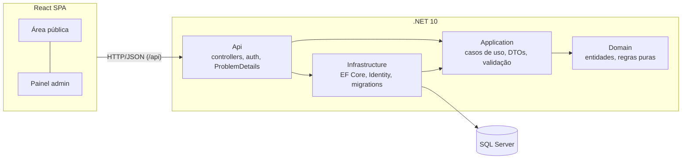
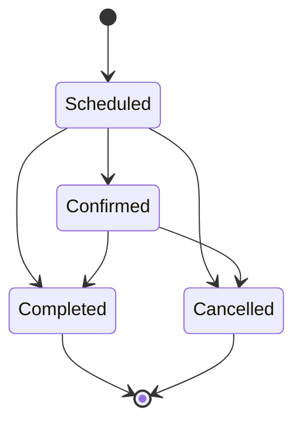
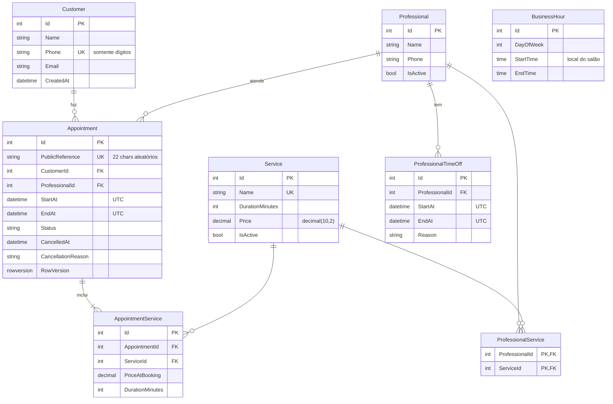

# BeautyAgenda

Aplicação web de **agendamento para um salão de beleza**. Clientes escolhem serviços, profissional e horário livre **sem criar conta**; a equipe gerencia agenda, cadastros, expediente e bloqueios em um painel autenticado.

O foco do projeto não é a quantidade de telas, e sim a **qualidade das regras de agendamento**: cálculo de disponibilidade, prevenção de conflitos (inclusive sob concorrência), máquina de estados e preservação de histórico — tudo validado no backend e coberto por testes automatizados.

| | |
|---|---|
| **Backend** | C# · .NET 10 · ASP.NET Core Web API · EF Core 10 · SQL Server 2022 · ASP.NET Core Identity + JWT · FluentValidation |
| **Frontend** | React 19 · TypeScript · Vite 8 · Tailwind CSS 4 · React Router 8 · TanStack Query 5 · React Hook Form + Zod 4 · FullCalendar 6 |
| **Testes** | xUnit · WebApplicationFactory · Testcontainers (SQL Server real em Docker) |
| **Infra** | Docker Compose (SQL Server + API + Nginx) · GitHub Actions · user-secrets |

---

## Sumário

- [Funcionalidades](#funcionalidades)
- [Arquitetura](#arquitetura)
- [Regras de negócio e decisões técnicas](#regras-de-negócio-e-decisões-técnicas)
- [Modelo de dados](#modelo-de-dados)
- [API](#api)
- [Segurança](#segurança)
- [Frontend](#frontend)
- [Testes](#testes)
- [Como executar](#como-executar)
- [Configuração](#configuração)
- [Estrutura de pastas](#estrutura-de-pastas)
- [Status e próximos passos](#status-e-próximos-passos)

**Documentação detalhada:** [arquitetura e decisões](docs/architecture.md) · [banco de dados](docs/database.md) · [regras de negócio → código → teste](docs/business-rules.md) · [roteiro para entrevistas](docs/interview.md)

---

## Funcionalidades

**Área pública (sem login)**
- Escolha de um ou mais serviços, com duração e preço total calculados.
- Escolha de profissional — ou "qualquer profissional", listando horários de todos os elegíveis.
- Horários livres por data, calculados pelo backend.
- Confirmação com **link secreto** para consultar ou cancelar o agendamento depois.
- Cancelamento online respeitando antecedência mínima configurável.

**Painel administrativo (autenticado)**
- Dashboard com indicadores do dia, da semana e receita prevista/realizada do mês.
- Agenda semanal/diária/mensal (FullCalendar) filtrável por profissional e status.
- Lista de agendamentos com filtros e paginação.
- Detalhe do agendamento: confirmar, concluir, **reagendar** (com sugestões de horários livres e troca de profissional) e **cancelar** com motivo.
- Cadastro de clientes (busca + paginação), serviços, profissionais e os serviços que cada um realiza.
- Folgas e bloqueios por profissional.
- Expediente semanal do salão com múltiplos intervalos por dia (ex.: pausa de almoço).
- Perfis **Admin** e **Staff** com permissões diferentes.

---

## Arquitetura

Monólito em camadas (inspirado em Clean Architecture), proporcional ao escopo de um único salão — sem microserviços, CQRS ou repositórios genéricos.



| Projeto | Responsabilidade | Depende de |
|---|---|---|
| `BeautyAgenda.Domain` | Entidades, enums, `TimeRange`, `AvailabilityCalculator` e a máquina de estados de `Appointment`. Sem dependências externas. | — |
| `BeautyAgenda.Application` | Casos de uso (`PublicBookingService`, `AppointmentsService`, `AvailabilityService`…), DTOs (records), validadores FluentValidation, opções de agendamento e `SalonClock` (fuso horário). | Domain |
| `BeautyAgenda.Infrastructure` | `AppDbContext` (EF Core + Identity), configurações de entidades, migrations, trava de agenda, emissão de JWT e seed. | Application |
| `BeautyAgenda.Api` | Controllers REST, autenticação/autorização, handler global de exceções, rate limiting, OpenAPI/Swagger. | Infrastructure |

**Decisões de desenho**
- **Sem padrão Repository:** a camada Application depende de `IApplicationDbContext` (DbSets + `SaveChangesAsync` + transação + lock). O `DbContext` já é a unidade de trabalho; um repositório genérico só esconderia o LINQ.
- **DTOs em todas as bordas:** nenhuma entidade do EF é serializada pelos endpoints. A área pública usa DTOs próprios, sem dados de clientes.
- **Exceções de aplicação → HTTP:** `ValidationException` → 400, `NotFoundException` → 404, `ConflictException`/`DomainException` → 409, demais → 500 genérico (sem detalhes internos). Tudo no formato RFC 7807 (`ProblemDetails`).
- **Tempo injetável:** `TimeProvider` + `SalonClock` permitem testes determinísticos com `FakeTimeProvider`.

---

## Regras de negócio e decisões técnicas

### 1. Disponibilidade

Um horário só é oferecido se **todas** as condições forem verdadeiras:

1. o profissional está ativo;
2. o profissional executa **todos** os serviços selecionados;
3. o atendimento cabe inteiro dentro de um intervalo do expediente;
4. não sobrepõe folga/bloqueio do profissional;
5. não sobrepõe outro agendamento ativo (`Scheduled` ou `Confirmed`);
6. respeita a política: antecedência mínima (padrão 60 min) e horizonte máximo (padrão 60 dias).

O cálculo fica em `AvailabilityCalculator` (Domain), uma **função pura**: recebe intervalos de trabalho, intervalos ocupados, duração, passo da grade e janela permitida, e devolve os slots. Por não tocar em banco, é testada exaustivamente com testes unitários. O `ScheduleReader` (Application) só carrega os dados e entrega ao calculador.

Intervalos são **semiabertos** `[início, fim)`. A sobreposição segue a regra:

```
NovoInicio < FimExistente  AND  NovoFim > InicioExistente
```

Por isso um atendimento que termina às 10:00 **não** conflita com outro que começa às 10:00. Intervalos de expediente encostados (09–12 e 12–18) são unidos; com pausa (09–12 e 13–18), um serviço não pode atravessar o intervalo.

### 2. Concorrência — duas pessoas, o mesmo horário

Checar disponibilidade e depois inserir **não é suficiente**: duas requisições simultâneas podem passar pela checagem antes de qualquer uma gravar. A reserva acontece assim:

```mermaid
sequenceDiagram
    participant A as Cliente A
    participant B as Cliente B
    participant API
    participant DB as SQL Server
    A->>API: POST /appointments (14:00)
    B->>API: POST /appointments (14:00)
    API->>DB: BEGIN TRAN + SELECT Professionals WITH (UPDLOCK, HOLDLOCK) WHERE Id = 3
    Note over DB: A obtém a trava; B espera
    API->>DB: recalcula disponibilidade + INSERT
    API->>DB: COMMIT (libera a trava)
    API-->>A: 201 Created
    API->>DB: (B) obtém a trava, recalcula: 14:00 ocupado
    API-->>B: 409 Conflict
```

- A trava é por **linha do profissional**: reservas para profissionais diferentes não se bloqueiam.
- Reagendamento trava os dois profissionais envolvidos **em ordem crescente de id**, evitando deadlock.
- Criação de bloqueio usa a mesma trava, então não é possível bloquear um período enquanto alguém reserva nele.
- `Appointment` tem `rowversion` (concorrência otimista) para mudanças de status simultâneas → 409.
- Provado por teste de integração: **10 requisições paralelas para o mesmo horário resultam em exatamente 1 × 201 e 9 × 409**, e apenas 1 registro no banco.

### 3. Duração, preço e histórico

- A duração é **sempre calculada no backend** somando os serviços; preço e duração enviados pelo navegador nunca são aceitos.
- Cada `AppointmentService` grava `PriceAtBooking` e `DurationMinutes` no momento da reserva. Alterar o preço de um serviço depois **não altera** agendamentos existentes (coberto por teste).
- Nada é apagado fisicamente: cancelamentos guardam `CancelledAt` e `CancellationReason`; serviços e profissionais são **desativados** (`IsActive`), não excluídos. FKs com `Restrict` impedem apagar histórico por acidente.
- Operações administrativas relevantes geram `AdminAuditLog` (quem, o quê, quando e um JSON curto com antes/depois), gravado na **mesma transação** da alteração.

### 4. Máquina de estados



As transições permitidas ficam na própria entidade (`Appointment.ChangeStatus`), que lança `DomainException` (→ 409) para transições inválidas. Só agendamentos `Scheduled`/`Confirmed` podem ser reagendados. O frontend espelha a tabela apenas para decidir quais botões exibir — **a fonte de verdade é o backend**.

### 5. Fuso horário

- Instantes são armazenados em **UTC** (`datetime2`). Um `ValueConverter` global garante que todo `DateTime` lido do banco venha com `Kind = Utc`.
- O expediente é guardado como `TimeOnly` no **horário local do salão** (`Salon:TimeZone`, padrão `America/Sao_Paulo`).
- A API responde datas como `DateTimeOffset` com o offset do salão (ex.: `2026-11-03T14:00:00-03:00`).
- O frontend formata e converte tudo no fuso do salão via `Intl`, independentemente do fuso do computador do visitante.
- "Hoje" é sempre o dia **no salão**: às 22:30 em São Paulo ainda é o mesmo dia, mesmo já sendo o dia seguinte em UTC (coberto por teste).

### 6. Clientes na área pública

O cliente é reconhecido pelo **telefone normalizado** (somente dígitos, índice único). Se já existir, o cadastro é reutilizado **sem sobrescrever** nome/e-mail com dados vindos de um formulário anônimo — evitando que qualquer pessoa altere os dados de outra só por saber o telefone.

---

## Modelo de dados



Além disso: tabelas do ASP.NET Core Identity (`AspNetUsers` com `FullName` e `IsActive`, roles etc.) e `AdminAuditLogs`.

**Integridade no banco** (não só na aplicação):
- índices únicos em `Customers.Phone`, `Services.Name` e `Appointments.PublicReference`;
- índice `(ProfessionalId, StartAt, EndAt)` em `Appointments`, que atende a consulta de sobreposição;
- check constraints: `StartAt < EndAt`, `DurationMinutes > 0`, `Price >= 0`, `StartTime < EndTime`;
- `Status` gravado como texto (legível em consultas SQL e estável se o enum for reordenado).

O schema é versionado por **migrations do EF Core** (`backend/src/BeautyAgenda.Infrastructure/Persistence/Migrations`).

---

## API

Documentação interativa em **`/swagger`** (ambiente de desenvolvimento), gerada a partir do OpenAPI nativo do .NET 10 (`/openapi/v1.json`).

| Área | Método e rota | Acesso |
|---|---|---|
| **Auth** | `POST /api/auth/login` · `GET /api/auth/me` | anônimo · autenticado |
| **Dashboard** | `GET /api/dashboard/summary` · `GET /api/dashboard/appointments?from&to&professionalId&includeCancelled` | Staff/Admin |
| **Clientes** | `GET /api/customers?search&page&pageSize` · `GET/PUT /api/customers/{id}` · `POST /api/customers` | Staff/Admin |
| **Serviços** | `GET /api/services` · `POST /api/services` · `PUT /api/services/{id}` | leitura Staff · escrita **Admin** |
| **Profissionais** | `GET/POST /api/professionals` · `PUT /api/professionals/{id}` · `PUT /api/professionals/{id}/services` | leitura Staff · escrita **Admin** |
| **Bloqueios** | `GET/POST /api/professionals/{id}/time-offs` · `DELETE /api/professionals/{id}/time-offs/{timeOffId}` | Staff/Admin |
| **Expediente** | `GET /api/business-hours` · `PUT /api/business-hours` (substitui a semana) | leitura Staff · escrita **Admin** |
| **Agendamentos** | `GET /api/appointments?from&to&professionalId&customerId&status&page&pageSize` · `GET /api/appointments/{id}` · `PATCH /api/appointments/{id}/status` · `POST /api/appointments/{id}/reschedule` · `POST /api/appointments/{id}/cancel` | Staff/Admin |
| **Público** | `GET /api/public/services` · `GET /api/public/professionals` · `GET /api/public/availability?date&serviceIds&professionalId` · `POST /api/public/appointments` · `GET /api/public/appointments/{reference}` · `POST /api/public/appointments/{reference}/cancel` | anônimo |
| **Saúde** | `GET /health` (inclui checagem do banco) | anônimo |

**Códigos de resposta:** `200`, `201 Created` (com `Location`), `204`, `400` (com `errors` por campo), `401`, `403`, `404`, `409` (conflito de horário ou de estado) e `429` (rate limit).

Exemplo — consultar disponibilidade e reservar:

```http
GET /api/public/availability?date=2026-11-03&serviceIds=1&serviceIds=3

200 OK
{
  "date": "2026-11-03",
  "durationMinutes": 105,
  "totalPrice": 150.00,
  "professionals": [
    { "professionalId": 1, "professionalName": "Ana Souza",
      "slots": [ { "startAt": "2026-11-03T09:00:00-03:00", "endAt": "2026-11-03T10:45:00-03:00" }, ... ] }
  ]
}
```

```http
POST /api/public/appointments
{ "professionalId": 1, "serviceIds": [1, 3], "startAt": "2026-11-03T09:00:00-03:00",
  "customerName": "Juliana", "customerPhone": "(11) 98765-4321", "customerEmail": null }

201 Created   → { "reference": "1sRlLr7NHPbbQX6Kog2kMg", "status": "Scheduled", ... }
409 Conflict  → horário ocupado entre a consulta e a reserva
```

---

## Segurança

- **Autenticação:** ASP.NET Core Identity (hash de senha, bloqueio após 5 tentativas por 15 min) + **JWT Bearer** assinado com HMAC-SHA256.
- **Secure by default:** uma *fallback policy* exige usuário autenticado em **todo** endpoint; os públicos são marcados explicitamente com `[AllowAnonymous]`.
- **Autorização por perfil:** `Admin` gerencia catálogo, profissionais e expediente; `Staff` opera agenda, clientes e bloqueios. Testes garantem os 403.
- **Conta desativada perde acesso na hora:** o token é revalidado contra `IsActive` a cada requisição.
- **Login sem enumeração de usuários:** senha errada, usuário inexistente ou inativo retornam o mesmo 401.
- **Referência pública imprevisível:** 128 bits de `RandomNumberGenerator` em base64url — não derivável do id. Referência malformada e inexistente recebem a mesma resposta 404.
- **Sem dados pessoais na área pública:** os DTOs públicos não têm campos de cliente nem telefone de profissional (verificado por teste).
- **Rate limiting** por IP no login e nas escritas públicas.
- **Validação em todas as entradas** (FluentValidation) e limites de tamanho alinhados às colunas do banco.
- **Segredos fora do repositório:** connection string, chave JWT e senhas iniciais em *user-secrets* (dev) ou variáveis de ambiente. O `.env` do Docker é ignorado pelo git.
- Logs não registram senhas nem tokens; erros 500 não expõem stack trace ao cliente.

> O frontend guarda o JWT em `localStorage`, o que é prático para uma SPA de demonstração, mas é exposto a XSS. Em produção, a alternativa recomendada é um cookie `HttpOnly` + `SameSite` emitido pela API.

---

## Frontend

SPA em React + TypeScript (`strict`), organizada por funcionalidade (`src/features/*`).

- **TanStack Query** para cache e sincronização com a API; mutações invalidam as consultas afetadas (ex.: reagendar atualiza agenda, lista, dashboard e disponibilidade pública).
- **React Hook Form + Zod** nos formulários, com validação imediata no cliente **e** mapeamento dos erros 400 do servidor para os campos (`applyServerErrors`). A validação do cliente é conveniência; a regra vale no backend.
- **Conflito tratado na UX:** se o horário for ocupado entre a escolha e a confirmação (409), o usuário volta para a etapa de horários com um aviso e a lista é recarregada.
- **Code splitting:** as telas administrativas e o FullCalendar são carregados sob demanda (`lazy` do React Router); o visitante da área pública baixa ~160 kB gzip.
- **Fuso do salão:** `src/lib/datetime.ts` formata e monta datas ISO com o offset correto de `America/Sao_Paulo`.
- Componentes de UI próprios com Tailwind (sem biblioteca de componentes), com estados de carregamento, vazio e erro, foco visível, labels associados e layout responsivo.

---

## Testes

O pipeline de CI executa todas as etapas abaixo a cada push e pull request.

```bash
cd backend
dotnet test                                    # tudo (requer Docker em execução)
dotnet test tests/BeautyAgenda.UnitTests       # só unitários (sem Docker)
```

| Suíte | Qtde | O que cobre |
|---|---|---|
| **Unitários** (`BeautyAgenda.UnitTests`) | 57 | Sobreposição de intervalos, cálculo de slots (limite do expediente, pausa, duração somada, bloqueio parcial, adjacência, antecedência/horizonte), transições de estado, snapshot de preço, fuso horário, validação de expediente, mensagens em pt-BR, telefone e referência pública. Executam em < 1 s. |
| **Integração** (`BeautyAgenda.IntegrationTests`) | 41 | API completa via `WebApplicationFactory` contra **SQL Server real** em container (Testcontainers), com migrations aplicadas e relógio fixo. Cobre 401/403, CRUDs com 400/404/409, reserva, **concorrência (10 requisições paralelas → 1 sucesso)**, cancelamento pelo link, folga sobre atendimento (409), transições, reagendamento com conflito sem alterar o original, preços preservados e ausência de dados pessoais nas respostas públicas. |

Os testes unitários validam as **regras**; os de integração validam o que só existe com a infraestrutura real: SQL gerado pelo EF, transações, travas e serialização HTTP.

Frontend:

```bash
cd frontend
npm run typecheck   # tsc --strict
npm run lint        # ESLint
npm run build       # build de produção
```

---

## Como executar

Há dois modos: **stack completo em Docker** (mais rápido para avaliar) ou **desenvolvimento local** (API e frontend rodando na máquina, com hot reload).

### Opção A — Stack completo com Docker

```bash
cp .env.example .env      # ajuste MSSQL_SA_PASSWORD, JWT_KEY e ADMIN_PASSWORD
docker compose up -d --build
```

- Aplicação: http://localhost:8080 (agendamento) e http://localhost:8080/admin (painel, com `ADMIN_EMAIL` / `ADMIN_PASSWORD`)
- O Nginx serve o frontend e faz proxy de `/api` para a API, na mesma origem e sem CORS. A porta da API não é exposta.
- A API aplica as migrations e cria os dados de demonstração na primeira subida (`DEMO_DATA=true`).
- Imagens: API em `aspnet:10.0`, rodando como usuário não-root; frontend em `nginx:alpine`, com cache longo para os assets com hash e cabeçalhos de segurança.

### Opção B — Desenvolvimento local

#### Pré-requisitos

- [.NET SDK 10](https://dotnet.microsoft.com/download)
- [Node.js 20+](https://nodejs.org/) (desenvolvido com Node 24)
- [Docker Desktop](https://www.docker.com/products/docker-desktop/) (SQL Server e testes de integração)
- Ferramenta do EF Core: `dotnet tool install -g dotnet-ef`

#### 1. Banco de dados

```bash
cp .env.example .env          # defina uma senha forte em MSSQL_SA_PASSWORD
docker compose up -d sqlserver
```

O SQL Server fica em `localhost,14333`.

#### 2. Configuração da API (segredos locais)

```bash
cd backend/src/BeautyAgenda.Api
dotnet user-secrets set "ConnectionStrings:Default" "Server=localhost,14333;Database=BeautyAgenda;User Id=sa;Password=<MSSQL_SA_PASSWORD>;TrustServerCertificate=True"
dotnet user-secrets set "Jwt:Key" "<uma chave aleatória com 32+ caracteres>"
dotnet user-secrets set "Seed:AdminEmail" "admin@beautyagenda.local"
dotnet user-secrets set "Seed:AdminPassword" "<senha com 8+ caracteres, maiúscula, minúscula e número>"
# opcional: usuário com perfil Staff
dotnet user-secrets set "Seed:StaffEmail" "recepcao@beautyagenda.local"
dotnet user-secrets set "Seed:StaffPassword" "<senha>"
```

#### 3. Migrations

Em `Development`, a API **aplica as migrations automaticamente** ao iniciar (`Database:ApplyMigrationsOnStartup`). Para aplicar manualmente:

```bash
cd backend
export BEAUTYAGENDA_CONNECTION="Server=localhost,14333;Database=BeautyAgenda;User Id=sa;Password=<senha>;TrustServerCertificate=True"
dotnet ef database update --project src/BeautyAgenda.Infrastructure --startup-project src/BeautyAgenda.Infrastructure
```

Para criar uma nova migration:

```bash
dotnet ef migrations add <Nome> --project src/BeautyAgenda.Infrastructure --startup-project src/BeautyAgenda.Infrastructure --output-dir Persistence/Migrations
```

#### 4. API

```bash
cd backend/src/BeautyAgenda.Api
dotnet run --launch-profile http
```

- API: http://localhost:5133
- Swagger: http://localhost:5133/swagger
- Health: http://localhost:5133/health

Na primeira execução em `Development` são criados os perfis, os usuários do seed e **dados de demonstração** (7 serviços, 3 profissionais, expediente de terça a sábado e alguns agendamentos).

#### 5. Frontend

```bash
cd frontend
npm install
npm run dev
```

- Agendamento público: http://localhost:5173
- Painel: http://localhost:5173/admin

O Vite faz proxy de `/api` para `http://localhost:5133` (ajustável com `VITE_API_PROXY`), então não há configuração de CORS no desenvolvimento.

### Solução de problemas

- **Docker não inicia no Windows / erro `CreateVm E_ABORT` ou "arquivo de paginação muito pequeno":** o WSL 2 precisa de memória virtual. Ative o arquivo de paginação (*Configurações avançadas do sistema → Desempenho → Memória virtual → Gerenciar automaticamente*) e reinicie. Opcionalmente, limite o WSL em `%USERPROFILE%\.wslconfig` (`[wsl2]` / `memory=4GB`).
- **Pasta dentro do OneDrive:** além de sincronizar `node_modules`, `bin` e `obj`, o OneDrive converte arquivos em *reparse points* ("Arquivos sob demanda"), e o `docker build` no Windows falha com `invalid file request`. Clone o projeto **fora** do OneDrive (ex.: `C:devBeautyAgenda`).

---

## Configuração

| Chave | Padrão | Descrição |
|---|---|---|
| `ConnectionStrings:Default` | — | Connection string do SQL Server (**segredo**). |
| `Jwt:Key` | — | Chave HMAC do JWT, 32+ caracteres (**segredo**). A API não inicia sem ela. |
| `Jwt:ExpiresMinutes` | `480` | Validade do token. |
| `Salon:TimeZone` | `America/Sao_Paulo` | Fuso IANA do salão (validado na inicialização). |
| `Scheduling:SlotIntervalMinutes` | `15` | Passo da grade de horários. |
| `Scheduling:MinAdvanceMinutes` | `60` | Antecedência mínima para reservar online. |
| `Scheduling:MaxAdvanceDays` | `60` | Horizonte máximo de agendamento. |
| `Scheduling:PublicCancellationMinNoticeHours` | `2` | Antecedência mínima para o cliente cancelar online. |
| `Scheduling:MaxServicesPerAppointment` | `5` | Limite de serviços por reserva. |
| `Database:ApplyMigrationsOnStartup` | `false` (`true` em Development) | Aplica migrations ao iniciar. |
| `Seed:AdminEmail` / `Seed:AdminPassword` | — | Cria o administrador inicial, se ainda não existir. |
| `Seed:StaffEmail` / `Seed:StaffPassword` | — | Cria um usuário Staff, se ainda não existir. |
| `Seed:DemoData` | `false` (`true` em Development) | Insere dados de demonstração se o catálogo estiver vazio. |
| `RateLimiting:PublicWritePerMinute` / `LoginPerMinute` | `20` / `10` | Limites por IP. |
| `Cors:AllowedOrigins` | `[]` | Origens permitidas quando o frontend é servido em outro domínio. |

Todas as opções podem ser definidas por variável de ambiente usando `__` como separador (ex.: `Scheduling__MinAdvanceMinutes=30`). Opções inválidas impedem a inicialização (`ValidateOnStart`).

---

## Estrutura de pastas

```
BeautyAgenda/
├── backend/
│   ├── BeautyAgenda.slnx
│   ├── Dockerfile
│   ├── src/
│   │   ├── BeautyAgenda.Domain/          # Entities/, Scheduling/ (TimeRange, AvailabilityCalculator)
│   │   ├── BeautyAgenda.Application/     # Appointments/, Availability/, Catalog/, Customers/, ...
│   │   ├── BeautyAgenda.Infrastructure/  # Persistence/ (DbContext, Configurations, Migrations), Identity/
│   │   └── BeautyAgenda.Api/             # Controllers/, Infrastructure/ (auth, erros, OpenAPI), Program.cs
│   └── tests/
│       ├── BeautyAgenda.UnitTests/
│       └── BeautyAgenda.IntegrationTests/  # ApiFactory (Testcontainers) + cenários
├── frontend/
│   ├── Dockerfile, nginx.conf
│   └── src/
│       ├── components/   # UI reutilizável
│       ├── features/     # booking, calendar, appointments, customers, professionals, services, ...
│       ├── layouts/      # PublicLayout, AdminLayout
│       ├── lib/          # cliente HTTP, auth, datas/fuso, rótulos
│       ├── routes/       # rotas e proteção
│       └── types/        # contratos da API
├── docs/            # arquitetura, banco, regras de negócio, roteiro de entrevista
├── .github/workflows/ci.yml
├── docker-compose.yml
└── .env.example
```

---

## Status e próximos passos

**Concluído**
- [x] Banco criado a partir das migrations
- [x] Cadastro de clientes, profissionais, serviços e associação profissional ↔ serviço
- [x] Cálculo de horários livres (expediente, duração, bloqueios, agendamentos, política)
- [x] Rejeição de reservas conflitantes, inclusive sob concorrência (testado)
- [x] Agendamento e cancelamento pela área pública
- [x] Visualização, confirmação, reagendamento e cancelamento pelo painel
- [x] Preservação de histórico e valores contratados
- [x] Endpoints protegidos por autenticação e perfis
- [x] Sem dados pessoais nos endpoints públicos
- [x] Testes automatizados das regras principais

- [x] Mensagens de erro da API em português
- [x] Documentação em `docs/`

**Em validação**
- [ ] Docker Compose completo e pipeline de CI: arquivos prontos, mas ainda não executados de ponta a ponta. O CI (`.github/workflows/ci.yml`) roda build e testes do backend com Testcontainers, checagem de tipos, lint e build do frontend, e monta as imagens Docker. Ele será validado no primeiro push ao GitHub.

**Próximos passos**
- [ ] Capturas de tela e demonstração online
- [ ] Testes para as lacunas listadas em [business-rules.md](docs/business-rules.md)
- [ ] Logs estruturados e rastreamento (Serilog / OpenTelemetry)

**Fora do escopo do MVP:** notificações por e-mail/WhatsApp, pagamentos online, emissão fiscal, múltiplas unidades e aplicativo mobile.
